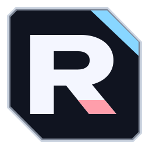
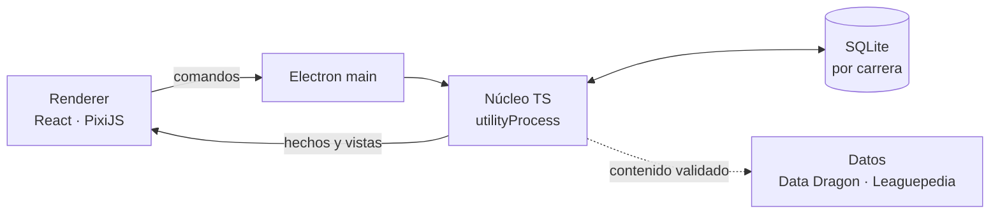
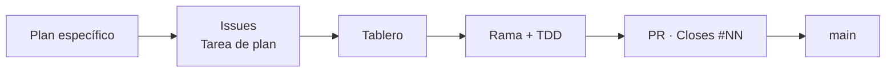

<div align="center">



# Rift Legends

**Gestión de esports de League of Legends para escritorio**

Diriges un equipo profesional: preparas el draft, gestionas la plantilla y compites temporada tras temporada.


</div>

> [!NOTE]
> Fan project gratuito y no oficial, sin afiliación con Riot Games ([aviso legal](NOTICE.md)). El proyecto está en la Fase 0, dedicada a los cimientos del monorepo y la app de escritorio.

## El juego

| | |
| --- | --- |
| **El draft es el momento estrella** | Picks y bans con presentación de retransmisión, fearless y una IA que explica sus decisiones |
| **Las decisiones importan** | Cada resultado se puede rastrear hasta sus causas: composición, forma, estrategia y meta |
| **Historias emergentes** | Rachas, rivalidades, dinastías y regens que surgen de la simulación, no de un guion |
| **Realismo competitivo** | LCK, LPL, LEC, LCS, CBLOL y LCP, con First Stand, MSI y Worlds |
| **Respeto por tu tiempo** | Juegas cada decisión o la delegas en el staff y avanzas rápido |

La visión completa está en [IDEA.md](IDEA.md).

## Stack

App de escritorio instalable que funciona sin conexión: no es una web ni tiene servidor.


| Capa | Tecnología |
| --- | --- |
| Núcleo | TypeScript puro y determinista (PRNG con semilla), en un proceso aparte |
| Persistencia | Un SQLite por carrera: estado actual más hechos *append-only* |
| Interfaz | React, shadcn/ui sobre Base UI, Tailwind, TanStack Table, Router y Query |
| Presentación | Motion para la UI y PixiJS (WebGL2) para el draft *broadcast* y el minimapa |
| Calidad | Vitest, fast-check, Testing Library, Playwright y Stryker |

El motivo de cada elección está en el [ADR 0001](docs/decisions/0001-stack-tecnologico.md), y el catálogo completo de librerías en [docs/libraries.md](docs/libraries.md).



## Hoja de ruta

| Fase | Hito |
| --- | --- |
| 0 · Cimientos | Monorepo, CI y estilo visual |
| 1 · Spikes | Validar el draft *broadcast*, las tablas densas y el determinismo |
| **2 · Draft rápido** | **Primer hito jugable: serie Bo5 fearless contra la IA** |
| 3–5 | Contenido real, competición y carrera |
| 6–8 | Mercado y regens, meta, scouting, moral y narrativa |
| 9–11 | Minimapa, ligas menores, Sandbox y releases |

El detalle está en el [plan general](docs/plans/00-plan-general.md), y el trabajo en curso en el [tablero](https://github.com/users/nbfrodri/projects/1).

## Cómo se trabaja



Rojo → verde → refactor en todo el código de producción. Commits Conventional y squash a `main` mediante PR. Las reglas completas están en [AGENTS.md](AGENTS.md).

## Inicio rápido

Necesitas Git y [mise](https://mise.jdx.dev/getting-started.html). Desde la raíz del repositorio clonado, instala las versiones de Node.js y pnpm fijadas en `mise.toml`, instala las dependencias y comprueba el monorepo.

```sh
mise install
mise exec -- pnpm install --frozen-lockfile
mise exec -- pnpm verify
```

`pnpm verify` ejecuta el lint, la comprobación de tipos, los tests y Knip para detectar código sin uso. Para ejecutar solo los tests:

```sh
mise exec -- pnpm test
```

La mutación de `packages/core` (Stryker, unos 3 minutos; se ejecuta al cerrar cada fase, no en cada PR) tiene su propio script y un workflow manual (`Mutation`):

```sh
mise exec -- pnpm mutation
```

Para arrancar la app de escritorio en modo desarrollo y para ejecutar los tests de extremo a extremo (compila la app y la prueba con Playwright):

```sh
mise exec -- pnpm dev
mise exec -- pnpm e2e
```

## Documentación

| Documento | Para qué |
| --- | --- |
| [IDEA.md](IDEA.md) | Visión del juego, pilares, bucles y sistemas |
| [docs/](docs/README.md) | Decisiones, planes, glosario, librerías e investigación |
| [design/](design/README.md) | Estilo visual (Caja), app con barra lateral e icono |
| [AGENTS.md](AGENTS.md) | Reglas y flujo de trabajo para agentes y personas |

## Licencia

El código se distribuye bajo [MIT](LICENSE-MIT) o [Apache-2.0](LICENSE-APACHE), a elección de quien lo use. Los nombres, imágenes y demás propiedad intelectual de League of Legends pertenecen a Riot Games y no están cubiertos por estas licencias ([NOTICE.md](NOTICE.md)).
