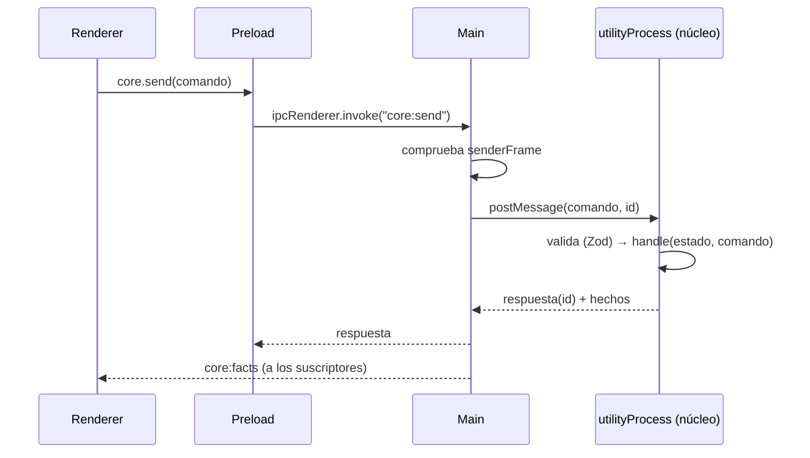

# Plan 04 — Contratos de IPC, comandos y hechos

- **Estado:** aprobado (20-11-2026). Redactado por Claude y aprobado por el usuario con las cuatro decisiones propuestas.
- **Fase:** 2 · Draft rápido completo ([plan general](00-plan-general.md)).
- **Objetivo:** fijar cómo habla la interfaz con el núcleo: un único canal tipado y validado, con comandos que producen hechos, consultas que devuelven vistas y errores que no alteran el estado. Los planes 06 a 09 añaden sus comandos y hechos sobre este marco sin rediseñarlo.

## Contexto

- **Arquitectura** ([plan general](00-plan-general.md#arquitectura-de-flujo), [ADR 0001](../decisions/0001-stack-tecnologico.md)): renderer → preload → main → `utilityProcess` del núcleo, que es la única autoridad. Hoy solo existen canales de ventana y de idioma (`apps/desktop/src/shared/bridge.ts`).
- **Evidencias de la Fase 1** ([ADR 0003](../decisions/0003-go-no-go-fase1.md)): en S3 un comando ilegal no consume RNG ni cambia el estado. En S7 el reintento con el mismo ordinal es idempotente y el `utilityProcess` sobrevive a un `SIGKILL` sin perder nada confirmado. Los hechos se codifican como tuplas JSON canónicas.
- **Alcance:** este plan cubre el marco y los comandos transversales (sesión, consulta y suscripción). Los comandos y hechos concretos del draft, la IA, la partida y el contenido los definen los planes 06, 07, 08 y 10, con este formato.

## Lista de tests

Por capa, en el orden en que se escriben. «Rojo» significa ver el test fallar por la razón indicada antes de implementar.

### Contratos (`packages/contracts`, Vitest + fast-check)

| # | Comportamiento | Caso límite |
| --- | --- | --- |
| C1 | Un sobre de comando válido pasa el esquema y conserva su tipo discriminado | `kind` desconocido, campos extra, `payload` ausente o con tipos erróneos → rechazo con ruta del error |
| C2 | Cada hecho del catálogo se serializa a su forma canónica y vuelve igual (ida y vuelta) | Propiedad (fast-check): para cualquier hecho generado, `decode(encode(f))` es igual a `f` y `encode` es estable byte a byte |
| C3 | La forma canónica es independiente del orden de construcción del objeto | Dos objetos con las mismas claves en distinto orden producen los mismos bytes |
| C4 | Los enteros de los contratos son enteros seguros | `NaN`, `Infinity`, decimales y valores fuera de `Number.MAX_SAFE_INTEGER` → rechazo |
| C5 | Una respuesta es siempre `ok` con hechos y posición, o `error` con código estable y clave i18n | Un código de error sin clave en los catálogos ES y EN hace fallar el test |
| C6 | La versión del contrato viaja en cada sobre | Versión distinta de la del núcleo → error `contract-mismatch`, sin ejecutar nada |

### Núcleo como servidor (`packages/core`, sin Electron)

| # | Comportamiento | Caso límite |
| --- | --- | --- |
| N1 | `handle(estado, comando)` devuelve el estado nuevo y los hechos emitidos, sin efectos fuera del valor devuelto | El estado de entrada no se muta (copia congelada en el test) |
| N2 | Un comando rechazado devuelve error y el estado **idéntico**, incluidos los RNG | Propiedad: secuencias aleatorias de comandos válidos e inválidos; quitar los inválidos produce el mismo estado y los mismos hechos |
| N3 | Cada hecho emitido lleva una posición consecutiva por sesión | Sin huecos ni repeticiones tras 1.000 comandos aleatorios |
| N4 | Reenviar un comando ya aplicado (mismo `expectedPosition`) devuelve los mismos hechos sin volver a aplicarlo | Reintento tras respuesta perdida; posición adelantada o atrasada → `stale-position` |
| N5 | Las consultas no cambian el estado ni emiten hechos | Propiedad: intercalar consultas no altera el log |

### Proceso del núcleo (`apps/desktop`, integración con `utilityProcess` real)

| # | Comportamiento | Caso límite |
| --- | --- | --- |
| P1 | main arranca el `utilityProcess`, que responde a un comando de prueba | El proceso tarda en arrancar: el comando espera, no se pierde |
| P2 | Un comando con forma inválida se rechaza en el `utilityProcess` sin llegar al dominio | Mensaje que no es JSON, binario o de más de 1 MiB |
| P3 | Solo el marco principal de la ventana puede enviar comandos | Petición desde otro `senderFrame` → rechazo y registro |
| P4 | Si el `utilityProcess` muere, main lo reinicia y las peticiones pendientes fallan con `core-restarted` | `SIGKILL` a mitad de comando; el reintento con la misma posición converge (N4) |
| P5 | Los hechos de un comando llegan a los suscriptores en orden y una sola vez | Dos suscriptores; uno se da de baja a mitad |
| P6 | Una petición sin respuesta en el plazo configurado falla con `core-timeout` | El núcleo bloqueado en un bucle (hook de test) |

### Renderer

| # | Comportamiento | Caso límite |
| --- | --- | --- |
| R1 | `window.riftlegends.core` expone solo `open`, `send`, `query` y `subscribe` (`open` crea la sesión), con tipos de `packages/contracts` | No hay acceso a `ipcRenderer` ni a canales arbitrarios |
| R2 | Un hook de consulta (TanStack Query) se invalida cuando llega un hecho que afecta a su vista | Hechos que no la afectan no provocan otra consulta |
| R3 | Un error del núcleo se muestra con su texto traducido | Cambio de idioma con el error visible |

### E2E (Playwright `_electron`)

| # | Comportamiento |
| --- | --- |
| E1 | Arrancar la app, crear una sesión de prueba, enviar un comando, ver el hecho reflejado en pantalla, matar el `utilityProcess` y comprobar que la app se recupera y el siguiente comando funciona |

## Diseño

### Paquete `packages/contracts`

- Tipos y esquemas **Zod 4** (catálogo: [libraries.md](../libraries.md)) de: sobre de comando, sobre de consulta, respuesta, error y hecho. El núcleo y la UI importan los tipos de aquí; nadie más define formas que crucen el IPC.
- **Sobre de comando:** `{ v, kind, sessionId, expectedPosition, payload }`. `v` es la versión del contrato. `expectedPosition` es la posición del siguiente hecho que el emisor espera: da idempotencia (N4) y ordena los reintentos, generalizando el ordinal de S7.
- **Hechos:** unión discriminada por `type`, con `position` y datos enteros. La forma canónica es JSON con claves ordenadas y una línea por hecho (S3 usaba tuplas; las claves con nombre facilitan migrar el esquema, y el orden fijo mantiene los bytes estables). El catálogo de hechos crece por módulo: `draft/`, `match/`, etc.
- **Respuesta:** `{ ok: true, position, facts }` o `{ ok: false, error: { code, params } }`. El código se traduce con la clave `errors.<code>` del catálogo i18n; el núcleo nunca devuelve texto para el usuario.
- **Consultas:** `{ v, kind, sessionId, params }` → vista (DTO). Las vistas son de solo lectura y se calculan a partir del estado.

### Flujo

- **main hace de relevo**: comprueba el marco emisor y reenvía. **El `utilityProcess` valida y decide**, porque es la autoridad. No se abre un `MessagePort` directo entre renderer y núcleo: añade superficie de seguridad y las medidas de T1 (latencia p95 de unos 30 ms) no lo necesitan.
- **Una cola por sesión** en el `utilityProcess`: los comandos se aplican de uno en uno, en orden de llegada.
- **Reinicio:** main vigila el proceso, lo relanza y rechaza las peticiones pendientes con `core-restarted` (P4). En la Fase 2 la sesión vive en memoria, así que un reinicio la pierde y la UI vuelve a empezar el draft. Cuando llegue la persistencia (plan 13), el reinicio la reabre desde SQLite con el protocolo validado en S7.

### Dónde vive cada cosa

| Pieza | Ubicación |
| --- | --- |
| Esquemas y tipos | `packages/contracts/` (`envelope.ts`, `errors.ts`, `facts/`, `views/`) |
| Despachador puro | `packages/core/server/` (`handle`, `query`, registro de comandos por módulo) |
| Proceso del núcleo | `apps/desktop/src/core-host/` (entrada del `utilityProcess`) |
| Relevo y vigilancia | `apps/desktop/src/main/core-bridge.ts` |
| API del preload | `apps/desktop/src/preload/` y `apps/desktop/src/shared/bridge.ts` |
| Hooks de UI | `apps/desktop/src/renderer/core/` (`useCoreQuery`, `useCoreCommand`, `useFacts`) |

## Troceado en issues (Tarea de plan · milestone «Fase 2 — Draft rápido completo»)

| Orden | Issue | Labels | Test que lo cierra |
| --- | --- | --- | --- |
| 1 | Crear `packages/contracts` con sobres, respuesta y errores | `type:task`, `area:core` | C1, C4, C5, C6 |
| 2 | Hechos con forma canónica estable | `type:task`, `area:core` | C2, C3 |
| 3 | Despachador puro del núcleo con idempotencia por posición | `type:task`, `area:core` | N1–N5 |
| 4 | Alojar el núcleo en un `utilityProcess` con relevo y vigilancia en main | `type:task`, `area:infra` | P1–P6 |
| 5 | API del preload y hooks de consulta, comando y hechos | `type:task`, `area:ui` | R1–R3 |
| 6 | E2E de comando, hecho y recuperación tras matar el núcleo | `type:task`, `area:infra` | E1 |

1 y 2 van en paralelo; 3 depende de ambos; 4 de 3; 5 de 4; 6 cierra el plan.

## Riesgos

- **Forma canónica frente a goldens:** si cambia la codificación de un hecho, cambian todos los goldens. El plan 05 fija cómo se versionan; aquí basta con que la codificación sea estable (C2, C3).
- **Tamaño de las vistas:** pasar vistas grandes (el mercado con miles de jugadores) por IPC puede costar. En la Fase 2 las vistas son pequeñas (un draft y una serie). Se medirá cuando lleguen las pantallas densas (plan 15).
- **Zod en el camino caliente:** validar cada comando tiene un coste. Los comandos del draft son pocos y pequeños; si una medida lo exige, se valida solo en desarrollo y en tests.

## Decisiones del usuario (20-11-2026)

1. main hace solo de relevo; la validación y la decisión están en el `utilityProcess`.
2. Idempotencia por `expectedPosition` en lugar de un ID de petición aleatorio, porque es determinista y es lo que validó S7.
3. Hechos con claves con nombre y forma canónica ordenada, en vez de las tuplas de S3.
4. En la Fase 2, sesión en memoria y sin SQLite. La persistencia entra con el plan 13 (Fase 5).
